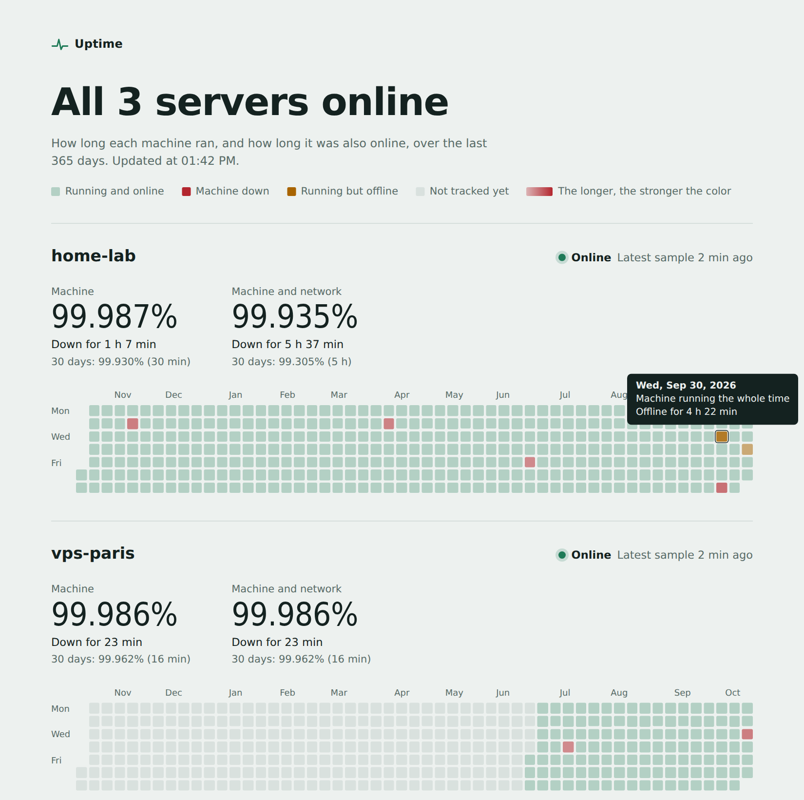

# Uptime

Machine and network uptime for any number of Linux servers, on a dashboard you host.



Every minute, each server checks two things about itself: that it's running, and that it's online (one of several
hosts answers a ping). It keeps what it finds until the dashboard has it, so a server cut off from the internet, or a
dashboard that's down, loses nothing: the samples arrive when the connection is back. No server watches another,
and none has to be online for the others to be measured.

The dashboard shows, for each server:

- **Machine**: the share of the time it was running, and how long it was down in total, over the last 365 days and
  the last 30.
- **Machine and network**: the same, for the time it was running *and* online.
- The year as a grid, a square per day like GitHub's: pale green when it ran and was online all day, red when the
  machine was down, amber when it ran but was offline, the stronger the color the longer. Hover over a day for its
  details.

History is kept for two years. Uptime counts from a server's first sample; until then it shows as not tracked yet.

## Install the dashboard

On the server that will host it (Linux with systemd), as root:

```sh
curl -fsSL https://raw.githubusercontent.com/boitech-dev/uptime/main/install.sh | sudo UPTIME_URL=https://uptime.example.com sh
```

`UPTIME_URL` is the address the dashboard will have. The installer gets its own copy of Node.js 24, runs the
dashboard as the `uptime` service on `127.0.0.1:3480`, creates the login and prints its password once, and installs
the `uptimectl` command. Running the same line again updates the dashboard and keeps its data and login.

Then serve that address over HTTPS through a proxy that keeps the `Host` header. With Caddy:

```
uptime.example.com {
	reverse_proxy 127.0.0.1:3480
}
```

With Apache (`a2enmod proxy_http headers ssl`, certificate from certbot):

```apache
<VirtualHost *:443>
	ServerName uptime.example.com
	ProxyPreserveHost On
	ProxyPass / http://127.0.0.1:3480/
	ProxyPassReverse / http://127.0.0.1:3480/
	SSLEngine on
	SSLCertificateFile /etc/letsencrypt/live/uptime.example.com/fullchain.pem
	SSLCertificateKeyFile /etc/letsencrypt/live/uptime.example.com/privkey.pem
</VirtualHost>
```

## Add a server

On the dashboard, under **Add a server**, give it a name: you get the one line to run on that server, as root. For
example:

```sh
curl -fsSL https://uptime.example.com/agent/install.sh | sudo UPTIME_URL=https://uptime.example.com UPTIME_TOKEN=upt_… sh
```

It installs the agent: a short shell script (it needs `curl` and `ping`), run every minute by a systemd timer as its
own user. To measure the dashboard's own server, add it the same way.

The agent pings `8.8.8.8 1.1.1.1 9.9.9.9 google.com` by default. To ping other hosts (an IPv6-only server, for
example), add a line like `UPTIME_HOSTS="2001:4860:4860::8888 2606:4700:4700::1111"` to `/etc/uptime-agent.conf`.

To remove the agent from a server:

```sh
systemctl disable --now uptime-agent.timer
rm /etc/systemd/system/uptime-agent.* /usr/local/bin/uptime-agent /etc/uptime-agent.conf
```

## The `uptimectl` command

On the dashboard's server:

| Command | What it does |
| --- | --- |
| `uptimectl add <name>` | Adds a server and prints the line that installs its agent |
| `uptimectl token <name>` | Gives a server a new token (the old one stops working) and prints its install line again |
| `uptimectl rename <name> <new name>` | Renames a server |
| `uptimectl remove <name>` | Removes a server and its history |
| `uptimectl list` | Lists the servers and their latest sample |
| `uptimectl password` | Hashes a new password read from stdin: put it in `/etc/uptime/env` as `UPTIME_PASSWORD_HASH`, then `systemctl restart uptime` |

## How it's measured

Each minute the agent writes one line, `<time> <boot time> <1 online | 0 offline>`, and sends the lines the dashboard
doesn't have yet (up to 10,000 at a time). The dashboard turns them into time spans:

- A sample proves the machine ran from its boot until then. So after a restart, the downtime is the time between
  the last sample before it and the new boot.
- An online sample proves the minute before it was online.
- Once a server has missed two minutes of samples, the time since its latest one counts as down until its samples
  arrive: from the dashboard, a server that's down and one that can't reach it look the same until it reports again.

Sending the same samples twice changes nothing, and samples can arrive in any order.

## Settings

The dashboard reads these from its environment (`/etc/uptime/env` when installed with the script):

| Variable | Default | |
| --- | --- | --- |
| `UPTIME_URL` | | The dashboard's public address, used in install commands |
| `UPTIME_USER`, `UPTIME_PASSWORD_HASH` | | The login (the hash comes from `uptimectl password`) |
| `UPTIME_OPEN` | | `1` for no login at all, like a public status page |
| `UPTIME_DB` | `uptime.db` | The SQLite database |
| `UPTIME_HOST`, `UPTIME_PORT` | `127.0.0.1`, `3480` | Where it listens |

## Development

Node.js 24, no runtime dependencies.

```sh
npm install        # TypeScript, for the type check only
npm test
npm run typecheck
UPTIME_OPEN=1 npm start
```

- `server/`: the dashboard (TypeScript, run by Node as is) and its page (`server/public`, no build).
- `agent/`: the agent (POSIX shell) and its installer.
- `install.sh`: the dashboard's installer.

## License

Uptime is free software: you can redistribute it and/or modify it under the terms of the GNU Affero General Public
License, version 3, as published by the Free Software Foundation. See [LICENSE](LICENSE).
